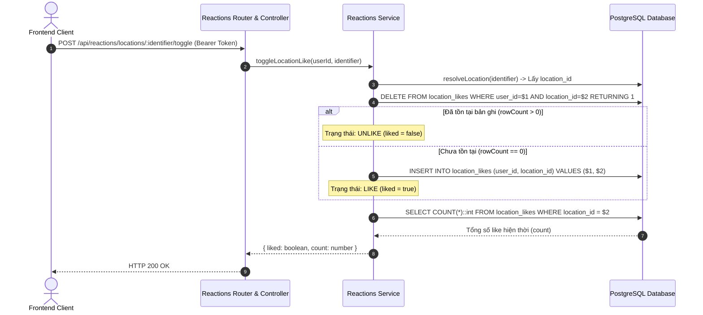

# Đặc Tả Kỹ Thuật Module Reactions (Yêu Thích & Tương Tác)

> **Dự án**: Website Kỷ niệm 40 năm THPT Nguyễn Công Trứ (`Website_NCT_40Years`)  
> **Module**: `reactions` | **Trạng thái**: Hoạt động ổn định  
> **Nền tảng**: Node.js (ES Modules) • Express 5 • PostgreSQL 16+

---

## 1. Mục Tiêu & Phạm Vi Nghiệp Vụ

Module `reactions` quản lý trạng thái tương tác yêu thích (Like / Unlike) của người dùng đối với hai thực thể chính:
1. **Địa điểm khuôn viên trường (`locations`)**: Ghi nhận sự quan tâm của học sinh, cựu học sinh và giáo viên đối với từng không gian trong trường.
2. **Bài viết kỷ niệm (`memories`)**: Bày tỏ sự đồng cảm đối với các câu chuyện và tư liệu do cựu học sinh chia sẻ.
3. **Bảng xếp hạng (`leaderboards`)**: Tổng hợp các không gian trường học nhận được nhiều lượt tương tác nhất.
4. **Hồ sơ cá nhân (`user profile`)**: Cung cấp danh sách các địa điểm và bài viết mà người dùng đã đánh dấu yêu thích.

---

## 2. Kiến Trúc & Cấu Trúc Mã Nguồn

Module tuân thủ cấu trúc 4 tầng chuẩn (`backend/src/modules/reactions/`):

```text
backend/src/modules/reactions/
├── reactions.schema.js      # Khai báo Zod Schema xác thực params & query
├── reactions.service.js     # Tầng nghiệp vụ & truy vấn cơ sở dữ liệu (PostgreSQL)
├── reactions.controller.js  # Tầng điều hướng HTTP request và response
└── reactions.routes.js      # Định tuyến REST API và gắn middleware
```

### Phân công trách nhiệm:
- **`reactions.schema.js`**: Xác thực kiểu dữ liệu `:identifier` (số nguyên `id` hoặc chuỗi `slug`), `:id` bài viết, kiểm tra số trang (`page`) và giới hạn bản ghi (`limit`).
- **`reactions.service.js`**: Thực thi logic Toggle nguyên tử (1-touch), xử lý bắt lỗi vi phạm ràng buộc toàn vẹn PostgreSQL (`23505`), tính toán lại tổng số like.
- **`reactions.controller.js`**: Trích xuất dữ liệu xác thực từ `req.validated_query`, `req.params`, lấy định danh `req.user.id` và trả kết quả JSON chuẩn hóa.
- **`reactions.routes.js`**: Ánh xạ URL, phân quyền truy cập (`requireAuth` cho các thao tác ghi dữ liệu, `optionalAuth` cho truy vấn hiển thị).

---

## 3. Thiết Kế Cơ Sở Dữ Liệu & Ràng Buộc Toàn Vẹn

Hệ thống sử dụng hai bảng quan hệ độc lập trong `backend/db/schema.sql`:

```sql
-- Lượt thích địa điểm
CREATE TABLE IF NOT EXISTS location_likes (
    user_id     INT NOT NULL REFERENCES users(id) ON DELETE CASCADE,
    location_id INT NOT NULL REFERENCES locations(id) ON DELETE CASCADE,
    created_at  TIMESTAMPTZ NOT NULL DEFAULT now(),
    PRIMARY KEY (user_id, location_id)
);

-- Lượt thích bài viết kỷ niệm
CREATE TABLE IF NOT EXISTS memory_likes (
    user_id     INT NOT NULL REFERENCES users(id) ON DELETE CASCADE,
    memory_id   INT NOT NULL REFERENCES memories(id) ON DELETE CASCADE,
    created_at  TIMESTAMPTZ NOT NULL DEFAULT now(),
    PRIMARY KEY (user_id, memory_id)
);

CREATE INDEX IF NOT EXISTS idx_location_likes_location_id ON location_likes (location_id);
CREATE INDEX IF NOT EXISTS idx_memory_likes_memory_id ON memory_likes (memory_id);
```

### Các nguyên tắc đảm bảo toàn vẹn:
- **Chống trùng lặp (Idempotency)**: Khóa chính phức hợp `PRIMARY KEY (user_id, location_id)` và `PRIMARY KEY (user_id, memory_id)` ngăn chặn hoàn toàn việc một người dùng tạo nhiều lượt like cho cùng một mục.
- **Xử lý Race-Condition**: Bắt mã lỗi PostgreSQL `23505` (Unique Violation) để trả về trạng thái nhất quán khi xảy ra xung đột đồng thời.
- **Toàn vẹn quan hệ (Cascade Deletion)**: Khi người dùng hoặc địa điểm/bài viết bị xóa, toàn bộ bản ghi tương tác tương ứng tự động được giải phóng.

---

## 4. Cơ Chế Xử Lý 1-Touch Atomic Toggle

Nhằm tối ưu hóa số vòng mạng (Network Round-trips) và hỗ trợ giao diện Optimistic UI ở Client, backend cung cấp endpoint Toggle theo luồng thực thi:



---

## 5. Danh Sách API Endpoints

### 5.1. Thao tác Toggle Địa Điểm (Toggle Location Like)
* **Endpoint**: `POST /api/reactions/locations/:identifier/toggle`
* **Xác thực**: Bắt buộc (`requireAuth`)
* **Tham số URL (`:identifier`)**: Số nguyên `id` (ví dụ `2`) hoặc chuỗi `slug` (ví dụ `san-truong`).
* **Headers**: `Authorization: Bearer <JWT_TOKEN>`
* **Response (HTTP 200 OK)**:
  * Khi thực hiện Like:
    ```json
    {
      "message": "Đã thích địa điểm",
      "locationId": 2,
      "locationSlug": "san-truong",
      "liked": true,
      "count": 43
    }
    ```
  * Khi thực hiện Unlike:
    ```json
    {
      "message": "Đã bỏ thích địa điểm",
      "locationId": 2,
      "locationSlug": "san-truong",
      "liked": false,
      "count": 42
    }
    ```

---

### 5.2. Thao tác Toggle Bài Viết Kỷ Niệm (Toggle Memory Like)
* **Endpoint**: `POST /api/reactions/memories/:id/toggle`
* **Xác thực**: Bắt buộc (`requireAuth`)
* **Tham số URL (`:id`)**: Số nguyên ID bài viết.
* **Headers**: `Authorization: Bearer <JWT_TOKEN>`
* **Response (HTTP 200 OK)**:
  ```json
  {
    "message": "Đã thích bài viết",
    "memoryId": 1,
    "liked": true,
    "count": 15
  }
  ```

---

### 5.3. Kiểm Tra Trạng Thái & Số Lượng Tương Tác
* **Endpoints**:
  * Địa điểm: `GET /api/reactions/locations/:identifier`
  * Bài viết: `GET /api/reactions/memories/:id`
* **Xác thực**: Tùy chọn (`optionalAuth` - nếu gửi kèm Bearer Token sẽ tính toán trường `hasLiked`).
* **Response (HTTP 200 OK)**:
  ```json
  {
    "locationId": 2,
    "locationSlug": "san-truong",
    "likeCount": 42,
    "hasLiked": true
  }
  ```

---

### 5.4. Danh Sách Người Đã Thích Địa Điểm
* **Endpoint**: `GET /api/reactions/locations/:identifier/likers`
* **Xác thực**: Công khai
* **Query Parameters**:
  * `page` (number, mặc định `1`): Số thứ tự trang.
  * `limit` (number, mặc định `20`, tối đa `50`): Số lượng bản ghi mỗi trang.
* **Response (HTTP 200 OK)**:
  ```json
  {
    "locationId": 2,
    "pagination": {
      "page": 1,
      "limit": 20,
      "total": 42,
      "totalPages": 3
    },
    "likers": [
      {
        "id": 1,
        "displayName": "Nguyễn Văn An",
        "role": "alumni",
        "cohort": "2015-2018",
        "className": "12A3",
        "avatarUrl": null,
        "likedAt": "2026-10-06T15:20:00.000Z"
      }
    ]
  }
  ```

---

### 5.5. Bảng Xếp Hạng Địa Điểm Được Yêu Thích (Leaderboard)
* **Endpoint**: `GET /api/reactions/locations/leaderboard`
* **Xác thực**: Công khai
* **Query Parameters**: `limit` (number, mặc định `10`, tối đa `50`).
* **Response (HTTP 200 OK)**:
  ```json
  [
    { "id": 2, "slug": "san-truong", "name": "Sân trường", "like_count": 85 },
    { "id": 3, "slug": "can-tin", "name": "Căn tin", "like_count": 64 },
    { "id": 4, "slug": "bon-cay", "name": "Bồn cây", "like_count": 52 }
  ]
  ```

---

### 5.6. Danh Sách Mục Đã Thích Của Bản Thân
* **Endpoints**:
  * Địa điểm cá nhân đã thích: `GET /api/reactions/me/locations`
  * Bài viết cá nhân đã thích: `GET /api/reactions/me/memories`
* **Xác thực**: Bắt buộc (`requireAuth`)
* **Query Parameters**: `page` (number), `limit` (number).
* **Response (HTTP 200 OK)**: Trả về danh sách dữ liệu kèm phân trang chuẩn hóa.

---

## 6. Mẫu Lệnh Kiểm Thử Kỹ Thuật (cURL)

```bash
# 1. Toggle like địa điểm theo Slug
curl -X POST http://localhost:3000/api/reactions/locations/san-truong/toggle \
  -H "Authorization: Bearer <TOKEN>"

# 2. Truy vấn trạng thái like của cá nhân đối với địa điểm
curl -X GET http://localhost:3000/api/reactions/locations/san-truong \
  -H "Authorization: Bearer <TOKEN>"

# 3. Lấy danh sách thành viên đã like địa điểm
curl -X GET "http://localhost:3000/api/reactions/locations/san-truong/likers?page=1&limit=10"

# 4. Lấy bảng xếp hạng địa điểm nhiều lượt thích nhất
curl -X GET "http://localhost:3000/api/reactions/locations/leaderboard?limit=5"

# 5. Lấy danh sách địa điểm cá nhân đã thích
curl -X GET "http://localhost:3000/api/reactions/me/locations?page=1&limit=10" \
  -H "Authorization: Bearer <TOKEN>"
```

---

## 7. Tiêu Chuẩn Triển Khai Phía Client (Frontend Guidelines)

1. **Optimistic UI Pattern**:
   * Khi kích hoạt sự kiện click trên component `LikeButton`:
     * Đổi ngay trạng thái visual (active/inactive) và cập nhật số lượng tức thời (`count ± 1`).
     * Phát request bất đồng bộ đến endpoint `/toggle`.
     * Trong trường hợp request thất bại (lỗi mạng hoặc mã `401`/`500`), thực hiện rollback trạng thái UI về giá trị ban đầu và hiển thị toast thông báo.
2. **Kiểm Soát Tần Suất (Debouncing / Throttling)**:
   * Áp dụng khóa nút tạm thời (disable state ~300ms) sau mỗi lần kích hoạt để hạn chế request liên tục.
3. **Xử Lý Trạng Thái Xác Thực (Authentication Interceptor)**:
   * Kiểm tra token trước khi gửi request toggle. Nếu chưa đăng nhập, mở modal điều hướng thay vì gửi request dẫn đến lỗi `401 Unauthorized`.
